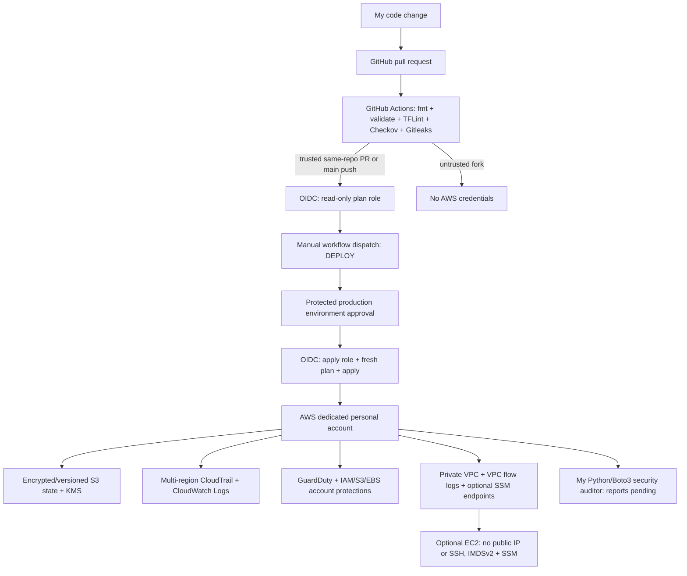

# Terraform Secure AWS Infrastructure + DevSecOps Pipeline

**Author:** Michael Morris | **Focus:** Cloud Security Engineering · Infrastructure as Code · DevSecOps

> **Status — source implementation complete; not yet deployed or validated in a live AWS account.** I have written the Terraform modules, security workflow, deployment scripts, and documentation. I will add real scan results, screenshots, and AWS audit evidence only after I run them. This repository does **not** include credentials, state, fake passing results, or fabricated metrics.

## Why I built this

I created this project to demonstrate that I can **engineer security into cloud infrastructure**, not just identify misconfigurations after deployment. I used Terraform to define an AWS security baseline and GitHub Actions to inspect infrastructure changes before I approve any deployment. I designed the deployment around short-lived GitHub OIDC credentials, centralized audit logs, private networking, and continuous verification.

My end goal is to connect this project with my Python AWS Security Configuration Auditor: first I provision the baseline, then I independently audit the account, fix anything I missed, and document the outcome.

## Architecture



The one-time **bootstrap** stack creates the remote-state infrastructure and GitHub OIDC principals. The **dev** stack cannot change its own OIDC trust policies because it manages a separate Terraform state and contains no OIDC module.

## What I implemented in code

| Area | Implementation | Why it matters |
|---|---|---|
| State | Private S3, KMS encryption, object versioning, TLS-only policies, access logging, S3 native locking | Protects and serializes infrastructure state |
| Account baseline | Account-wide S3 public-access block, EBS default encryption, 14-character IAM password policy | Establishes preventive controls |
| Audit logging | Multi-region CloudTrail, log file validation, KMS-protected S3 and CloudWatch logs, flow logs | Preserves investigation evidence |
| Detection | GuardDuty with S3 data events | Enables detection signals (usage charges apply) |
| Network | Two private subnets, no NAT or internet gateway, locked default security group, S3 gateway endpoint | Reduces exposure |
| Compute | Opt-in Amazon Linux EC2 with SSM IAM role, IMDSv2, encrypted EBS, no SSH/public IP | Demonstrates hardened private administration |
| CI/CD | PR checks, same-repo AWS plan, explicit dispatch + protected environment apply | Helps prevent insecure and accidental deployment |
| Repo security | Gitleaks, Checkov, TFLint, pre-commit, Dependabot | Finds issues before changes reach AWS |

The optional private instance automatically enables three **billable interface VPC endpoints** (`ssm`, `ssmmessages`, `ec2messages`). By default, I keep EC2 and those endpoints disabled.

## Repository layout

```text
terraform-secure-aws/
├── bootstrap/                # State buckets, KMS, OIDC plan/apply roles
├── envs/dev/                 # Deployment root with S3 backend
├── modules/
│   ├── account-baseline/    # S3/EBS/IAM account controls
│   ├── secure-s3/           # Reusable encrypted bucket
│   ├── logging/             # CloudTrail, S3, CloudWatch, KMS
│   ├── network/             # Private VPC, flow logs, endpoints
│   ├── detection/           # GuardDuty
│   ├── compute/             # Optional hardened SSM-managed EC2
│   └── github-oidc/         # Bootstrap-only CI identities
├── .github/workflows/       # Scan, plan, manually approved apply
├── scripts/                 # Backend setup and AWS verification
├── docs/                    # Threat model, test plan, control mapping
└── tests/                   # Offline repository safety tests
```

## How I deploy this on my Windows laptop

**Prerequisites:** A *dedicated personal AWS account*, root MFA, a non-root administrator with MFA, AWS CLI v2, Terraform >= 1.10, Git, PowerShell, Python 3.11+, TFLint, Checkov, and Gitleaks. I do not deploy in a school or employer account.

**Before deploying:** I create an AWS Budget with a **$10/month threshold** and alert emails at 50% and 100%. Budget alerts are not a hard spending cap. I verify AWS pricing and monitor Bills/Cost Explorer. As an optional additional IaC check, `bootstrap/budget.tf` creates this budget if I supply `-var="budget_email=my-address@example.com"`; the default deliberately creates no budget because I have not supplied an email.

1. I sign in through IAM Identity Center (preferred) and check my CLI identity:

   ```powershell
   aws configure sso --profile tfsec-lab
   aws sso login --profile tfsec-lab
   $env:AWS_PROFILE = 'tfsec-lab'
   aws sts get-caller-identity
   ```

2. I inspect the `bootstrap/` configuration before running any command. I then create the remote state and OIDC identities from an **administrator-controlled local state**:

   ```powershell
   terraform fmt -recursive
   terraform -chdir=bootstrap init
   terraform -chdir=bootstrap fmt -check
   terraform -chdir=bootstrap validate
   terraform -chdir=bootstrap plan -out=bootstrap.tfplan
   terraform -chdir=bootstrap apply bootstrap.tfplan
   ```

   I verify that `github_owner` matches my actual GitHub account and `github_repo` matches the repository name before I apply. If either is different, I supply `-var='github_owner=...'` and `-var='github_repo=...'` to **both** the plan and later applicable commands.

3. I generate the ignored S3 backend config and initialize the dev stack:

   ```powershell
   .\scripts\configure-backend.ps1
   terraform -chdir=envs/dev init -backend-config=backend.hcl
   terraform -chdir=envs/dev validate
   terraform -chdir=envs/dev plan
   ```

4. I review the proposed changes, estimate costs, and only then use `terraform -chdir=envs/dev apply` for an initial local deployment. For the GitHub pipeline I configure **repository Actions variables** from bootstrap outputs:

   | GitHub Actions variable | Source |
   |---|---|
   | `PLAN_ROLE_ARN` | `terraform -chdir=bootstrap output -raw plan_role_arn` |
   | `APPLY_ROLE_ARN` | `terraform -chdir=bootstrap output -raw apply_role_arn` |
   | `TF_STATE_BUCKET` | `terraform -chdir=bootstrap output -raw state_bucket_name` |
   | `TF_STATE_KMS_KEY_ARN` | `terraform -chdir=bootstrap output -raw state_kms_key_arn` |

   I create a GitHub **production** environment and configure **required reviewers** and restrict it to `main`. I configure **main branch protection** requiring pull requests and passing checks. I verify the repository is public if my GitHub plan requires it for reviewer gating. I do not assume an environment named `production` automatically provides approval.

5. I push to a new branch and open a PR. The PR runs secret scanning, Terraform format/validation, TFLint, and Checkov. Until I configure the GitHub AWS role and state variables, the AWS plan job is safely skipped. Trusted **same-repository** PRs can use the read-only plan role; fork PRs do not receive AWS credentials. After merging, a new plan runs on `main`. To apply, I manually open **Actions → Terraform Secure AWS → Run workflow**, enter `DEPLOY`, and approve the protected environment. The apply job generates a fresh plan for the exact checked-out commit.

6. I collect real evidence using `scripts/verify-deployment.ps1`, then run my Python security auditor and save sanitized before/after reports under `docs/audit/`. Until I complete these steps, all evidence and claims are marked pending.

## Security validation and intentional failure cases

I designed the test plan to demonstrate actual rejected changes: public S3, public SSH (port 22), IMDSv1, bad formatting, and a synthetic secret. I also plan a safe passing-change test. **I have not claimed these tests have passed yet.** Full steps: [docs/negative-tests.md](docs/negative-tests.md).

My threat model is in [docs/threat-model.md](docs/threat-model.md). I mapped the control *areas* without inventing CIS benchmark control IDs in [docs/control-mapping.md](docs/control-mapping.md). I track known limits and scanning exceptions in [docs/exceptions.md](docs/exceptions.md).

## My design trade-offs and current limits

- **Apply access:** My initial deploy role has `PowerUserAccess` plus tightly scoped IAM workload-role exceptions. **PowerUserAccess is broader than least privilege.** I will use CloudTrail evidence and IAM Access Analyzer to replace it with a narrower policy after the first working deployment. My bootstrap identity manages OIDC roles separately so CI cannot change its own trust role.
- **Plan access:** I grant read access needed to refresh lab resources, plus S3 state read and S3 lock-file writes. A trusted same-repository PR can still see sensitive state through Terraform if its author can edit workflow code; I must restrict write collaborators and review workflow changes. Forks never receive the AWS plan role.
- **Approval gate:** I configured the workflow to **require manual dispatch** and reference a protected environment. GitHub reviewer settings must be configured in the UI. Without that setting, an environment name alone does not require reviewer approval.
- **Actions supply chain:** GitHub Action tags are used in this starter repository. Before enabling live deployments, I will pin third-party actions to full commit SHAs and verify the pin/update process. Dependabot is configured.
- **Lab scope:** One AWS account, one Terraform deployment region, multi-region CloudTrail, no NAT, no internet-facing app, no organization SCPs. Interface endpoints cost money while running.
- **Validation:** Offline structural tests can run without AWS; live Terraform `init/validate`, provider checks, Checkov/TFLint, AWS plan/apply and audit results must be performed in the connected environment. A scan finding is not proof of failure until a tool actually runs.
- **Costs:** KMS keys, GuardDuty, CloudWatch, S3 and endpoints may incur charges. Deleting the instance does not delete endpoints, logs, or KMS keys. See [docs/costs-and-cleanup.md](docs/costs-and-cleanup.md).

## What I will present to a recruiter after verification

I will add authentic screenshots of a blocked misconfiguration, a passing workflow, the manual deployment gate, CloudTrail/GuardDuty/flow logs, and my auditor's sanitized before/after findings. I will report only counts measured from the actual results, not estimates. My final resume description will be based on what I actually deployed, tested, and verified.

**Reference material:** My 15-page project guide, the [Terraform S3 backend](https://developer.hashicorp.com/terraform/language/backend/s3), [CloudTrail KMS policy](https://docs.aws.amazon.com/awscloudtrail/latest/userguide/create-kms-key-policy-for-cloudtrail.html), [CloudTrail S3 policy](https://docs.aws.amazon.com/awscloudtrail/latest/userguide/create-s3-bucket-policy-for-cloudtrail.html), [SSM interface endpoints](https://docs.aws.amazon.com/systems-manager/latest/userguide/setup-create-vpc.html), and [GitHub deployment approvals](https://docs.github.com/en/actions/how-tos/deploy/configure-and-manage-deployments/review-deployments).

**License:** MIT. This is an educational personal-security lab; review every change before deploying.
